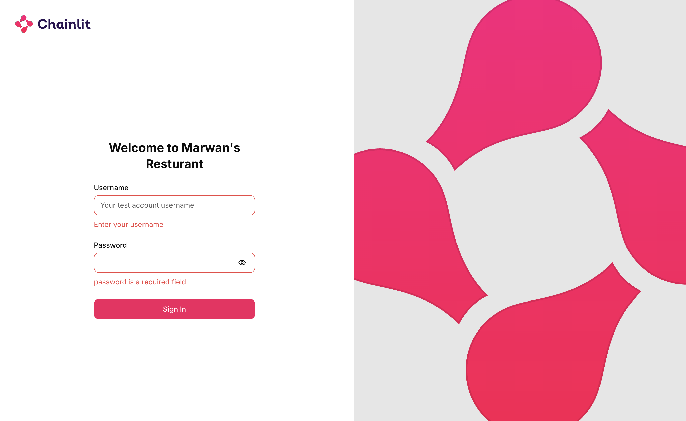
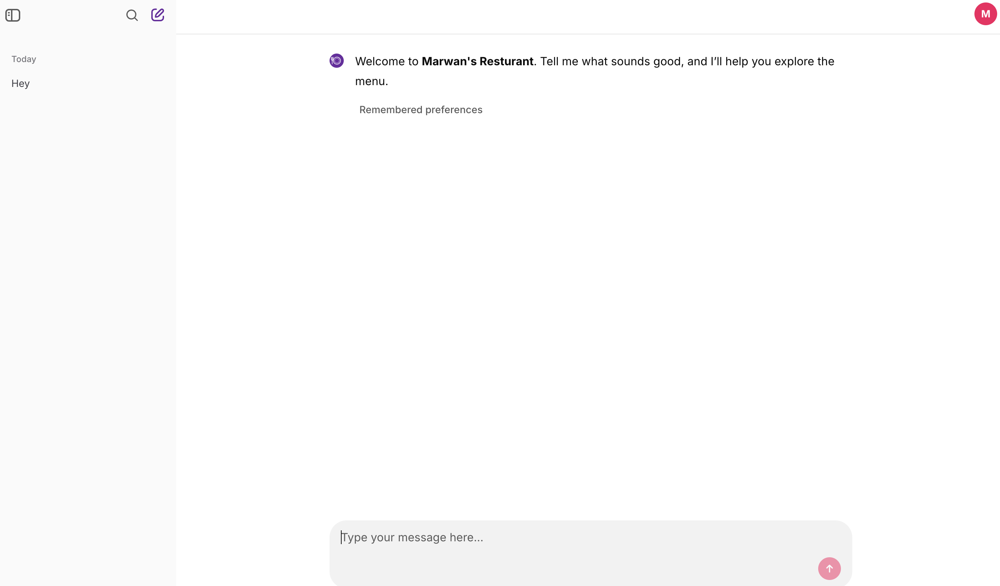
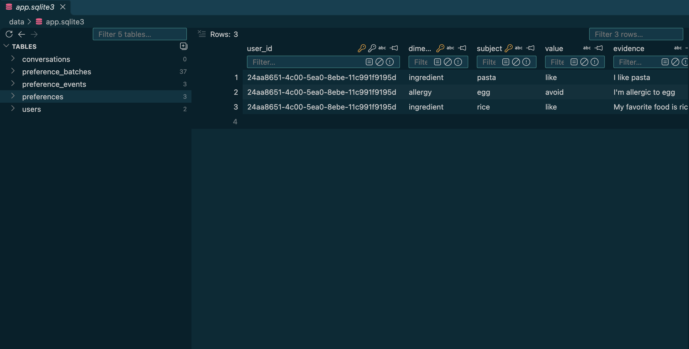

# Restaurant Menu Assistant

A conversational assistant that recommends dishes from a 50-item menu and remembers
user preferences across conversations. Built with Python, LangChain/LangGraph,
Chainlit, and SQLite.

Menu recipes come from [DummyJSON Recipes](https://dummyjson.com/docs/recipes).
We adapted the data for a fictional restaurant by adding menu categories, prices
in SAR, dietary classifications, and spice levels. These additions
are fictional demo annotations, not information provided by DummyJSON.

## Screenshots

**Login page**



**Chat interface**



**Saved preferences in SQLite**



## Run locally

Requires Python 3.11 and [uv](https://docs.astral.sh/uv/).

```sh
uv sync --frozen --no-dev
cp .env.example .env
uv run --no-dev python scripts/configure_accounts.py
```

The setup script creates two login accounts and an authentication secret. Add your
OpenRouter API key to `OPENROUTER_API_KEY` in `.env`. The default model is
`deepseek/deepseek-v4.1-flash`; change `MODEL_NAME` to use another compatible model.
Keep `.env` and credentials out of source control.

Start the app:

```sh
DEBUG=false uv run --no-dev python -m chainlit run app.py --host 127.0.0.1 --port 8000
```

Open [localhost:8000](http://localhost:8000) and sign in with an account you created.

## Architecture

```text
Chainlit chat and login
        ↓
LangGraph: load preferences → extract changes → save updates
        ↓
One conversational agent ↔ Python tools querying menu.json
        ↓
Validate selected items → display menu details
```

SQLite stores user preferences and their change history in `app.sqlite3`.
LangGraph stores conversation state in `checkpoints.sqlite3`. Both files live under
`DATA_DIR`, which defaults to `./data`.

## Key decisions

- **One agent and a separate extraction step:** the agent handles conversation;
  structured LLM extraction identifies preference changes and request constraints.
- **JSON menu with Python filtering:** 50 records do not require a menu database.
  Tools enforce constraints, and dish details come directly from menu records.
- **Separate lasting preferences and temporary requests:** “I prefer mild food” is
  remembered; “vegetarian tonight” applies only to the current request. An explicit
  request budget overrides the usual saved budget without changing it.
- **Traceable memory:** preference changes retain supporting evidence and history.
  Users have separate profiles and conversations.

Try saving a preference, starting **New chat**, and asking for recommendations.
Use **Remembered preferences** in the header to toggle the preferences panel.
The `/preferences` command also opens the panel. Preferences can
be corrected or forgotten through chat. “Start a new request” clears temporary
constraints while keeping saved preferences.

## Limitations and deployment

This is a fictional menu demo. Prices and dietary classifications are demo data.
Allergy exclusions match named ingredients against each dish’s ingredient list;
this does not establish allergy safety or detect hidden ingredients.
LLM interpretation and generated wording can still be incorrect.

The app is deployed on [CranL.com](https://cranl.com/).

The app runs as one instance; model calls are serialized. It is intended for a small
demo rather than high traffic. The supplied Dockerfile supports deployment with
WebSockets and a writable persistent disk at `/data`. Configure `OPENROUTER_API_KEY`,
`TEST_ACCOUNTS_JSON`, and a stable `CHAINLIT_AUTH_SECRET` on the host. Set `APP_URL`
to the deployed HTTPS origin and `CHAINLIT_COOKIE_SAMESITE=none` for HTTPS hosting.
