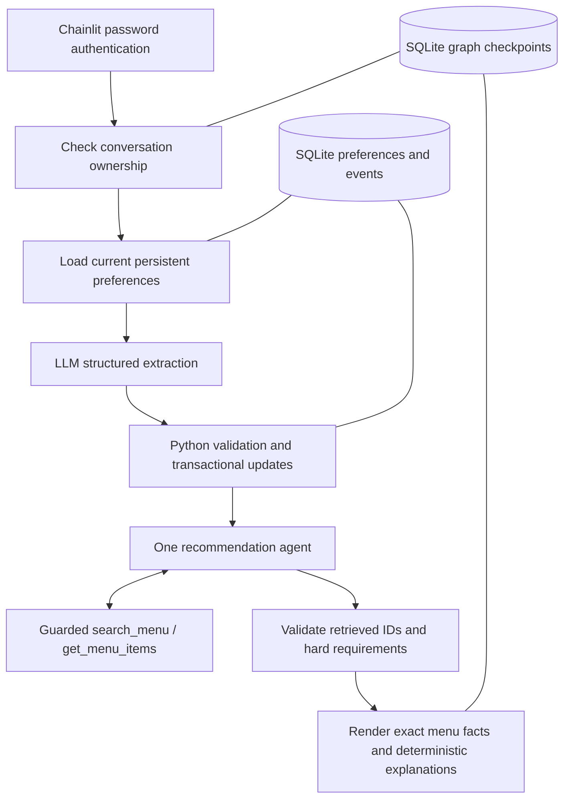

# Architecture and decisions

The default model is `deepseek/deepseek-v4.1-flash` through OpenRouter. OpenRouter
routing requires support for the requested parameters, and reasoning defaults off.

The extractor is a fixed graph node, never a second autonomous agent. It proposes
persistent preference edits, temporary constraint patches, explicit request resets and
forget operations. It does not classify conversational intent or gate information topics.
Greetings, thanks and capability questions normally propose no changes. Unknown hard
requirements are recorded as unsupported instead of invented facts. New requests clear
temporary state only when explicit; a new conversation starts with empty temporary state.

The repository validates exact supporting quotes before applying memory changes. SQL is
parameterized, and a transaction commits profile edits, their events and the idempotency
batch together. A `(user_id, dimension, subject)` key changes only one preference at a time.
Events retain old/new values, evidence, thread/message IDs and UTC timestamps. Exact-quote
validation proves provenance, not perfect semantic interpretation; live scenarios test that.

Budget uses explicit precedence: a numeric temporary budget wins over a saved usual budget.
Without a temporary budget, the saved default applies. The selected effective budget is hard
for all menu tools. This exception does not weaken saved dietary restrictions or allergies.
Numeric overrides persist through follow-ups, clear on new conversations, and never change
the saved default. Persistent corrections and removals require explicit memory edits.
An unlimited temporary override without a numeric budget is deferred for this baseline.
Persistent spice and cuisine/ingredient/dish affinities rank eligible records. Temporary
spice, ingredient exclusions, dietary restrictions and other request constraints are hard.

The recommendation agent owns all conversational decisions and wording. It receives recent
messages, the fresh saved profile and effective constraints, then uses `search_menu`,
`get_menu_items` and `respond`. `AssistantResponse` contains only `reply` and `item_ids`
(at most five). Social replies, memory answers and clarifications may call respond immediately
with no menu query and no IDs. The loop is bounded to four rounds/four calls per round,
with one invalid-response repair. There is no extra formatting model call.

Menu tools always intersect their arguments with active hard constraints. Selected IDs must
be known, retrieved, distinct and eligible. Price sorting considers all eligible records before
limiting results. Python renders exact names, prices, ingredients and images from the menu,
without replacing the agent's conversational reply. Free text stays brief and is instructed to
avoid unsupported claims; ID validation alone does not establish every generated sentence's
factual accuracy. Capability instructions cover unavailable calories, portions, certification,
customization and ordering. Unsupported hard requirements cannot produce eligible items.

Allergen filtering uses the `allergens` list and ignores `allergenStatus`. Allergy-filtered
cards display “Filtered using listed allergens”. Ordinary cards have no repeated warning.
The remembered-preferences UI and `/preferences` remain deterministic application actions;
repeated clicks update one block. Authentication, history projection, checkpointing,
completed-message retry handling and preference-event storage are unchanged.

## Storage and identity

| Store | Data |
| --- | --- |
| `app.sqlite3/users` | Stable UUID for the verified account; retained on a username rename |
| `app.sqlite3/conversations` | Owner UUID, thread UUID, title, timestamps, limited UI metadata |
| `app.sqlite3/preferences` | Current dimension/subject values, evidence and timestamps |
| `app.sqlite3/preference_events` | Change history including removals |
| `app.sqlite3/preference_batches` | Idempotency ledger, including messages with zero edits |
| `checkpoints.sqlite3` | LangGraph state/messages and checkpoint writes |

`user_id` always comes from Chainlit’s authenticated user, never message content or
model output. `thread_id` comes from the Chainlit session. The service checks ownership
before every state read or turn, and the history adapter checks ownership before
projecting checkpoints. HTTP principal context comes only from Chainlit’s post-JWT
user lookup; websocket reads use the authenticated session. Listing and deletion are
also scoped to the verified owner. Sharing, message editing and favorites are disabled.

A new thread has no previous messages or temporary constraints. A resumed thread
loads the same checkpoint. The profile is reloaded every turn so another conversation’s
correction is used immediately. Completed message retries reuse the saved answer;
the preference batch ledger also protects retries interrupted after a memory commit.
The SQLite/checkpoint stores are separate transactions: a crash can leave preference
updates committed before the answer checkpoint. Reprocessing is safe for preferences;
it may repeat a model request. A reused message ID with different text is rejected.

The custom Chainlit data layer projects checkpoint messages into UI steps. It does
not persist another transcript, elements or tool traces. Recommendation images are
canonical Markdown links to the original menu URLs, so cards survive resumption.
Welcome messages and derived preference views are transient UI affordances and are
not chat history. After resuming, type `/preferences` to reopen that view. Retained
assistant replies are already rendered facts, rather than fresh model-generated claims.
Removing a conversation deletes its checkpoints; preference history remains.

## Operational trade-offs

One process and one instance share a service lock, keeping graph turns and preference
refreshes easy to reason about. A slow model call queues other turns. This baseline
is suited to an interview/demo, not high traffic. SQLite WAL and transactions protect
repository access; scale-out would require another persistence/concurrency design.
There is no message summarizer or automatic checkpoint pruning, so storage grows.
Only recent messages are sent to models; complete history remains in checkpoints.
Authentication is two configured password accounts, without self-service signup,
password reset, or an application-specific rate limiter. Deploy behind HTTPS.
The service stores no plaintext passwords in SQLite. Provider errors log only controlled
diagnostics and HTTP status, never raw response bodies, prompts or credentials; other
turn failures log exception types. Authentication, entitlement, credits, rate limits,
network failures and rejected integration requests receive service-specific UI messages,
separate from extraction/validation failures. Any local generated password file is private and ignored.

Deployment files are supplied; no deployed URL is claimed. Hosting deployment remains
with the project owner.
